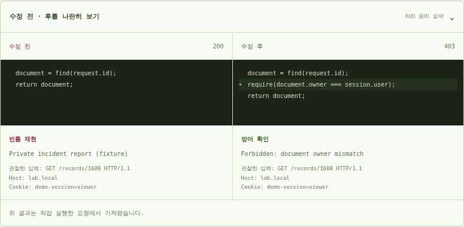
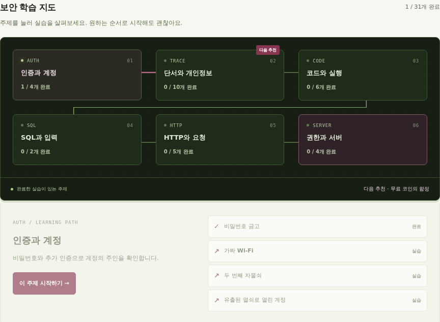

# 다섯 가지 디자인 효과와 주요 코드

멋있는 첫인상과 읽기 쉬운 학습 화면을 함께 유지합니다. 버건디는 선택과 다음 목표, 카고색은 안내와 완료 기록에 사용합니다. 모든 움직임은 운영체제의 ‘움직임 줄이기’를 따릅니다.

## 1. 문자가 모여 만드는 실루엣

[`site/hero.mjs`](../site/hero.mjs)의 `resize()`가 후드 안의 문자 목표 좌표를 만들고, `paint()`가 흘러내리는 위치와 목표 위치를 섞습니다.

```js
const x = startX + (targetX - startX) * blend;
```

`blend`가 0이면 원래 위치, 1이면 인물의 윤곽에 도착합니다. 천천히 모이고 잠깐 머문 뒤 흩어지는 주기를 만듭니다. 모바일, 화면 밖 재생 중지, 멈춤 버튼은 기존 첫 화면 제어와 연결됩니다.

## 2. 실제 요청을 따라가는 빛

[`site/experience.mjs`](../site/experience.mjs)의 `begin()`은 원래 실행 함수가 시작할 때 빛을 서버 방향으로 보냅니다. `finish()`는 실제 응답에서 정상 처리·빈틈 재현·방어 확인을 읽고 응답 방향으로 빛을 보냅니다.

`site/motion.mjs`의 실행 래퍼에 연결하며, 연출을 위해 서버 요청을 추가하거나 실제 응답을 지연하지 않습니다. 빠른 로컬 응답은 결과가 도착한 뒤 한 번의 이동으로 흐름을 보여줍니다.

## 3. 단서 조사 스캔

`scan()`은 문제를 열었을 때 조작 영역을 버건디 선으로 한 번 훑습니다. 사용자가 직접 주소나 코드 줄을 누르면 그 부분에 짧은 반응을 줍니다. 정답 선택지 자체를 미리 표시하지 않습니다. 선은 클릭과 키보드 입력을 가로막지 않습니다.

## 4. 수정 전후 코드와 실행 증거



`renderComparison()`은 읽기 쉬운 처리 원리와 직접 실행한 결과를 나란히 표시합니다. SQL은 응답에 포함된 실제 쿼리와 매개변수, 응용 실습은 제공된 검사 코드를 사용합니다. 전문 챕터의 권한·역할·요청 제한 코드는 ‘처리 원리 요약’으로 구별합니다.

입력이나 패치가 바뀌면 현재 선택에 맞지 않는 수정 후 증거를 ‘실행 전’으로 돌립니다. 관찰한 입력도 함께 보여주며, 서로 다른 입력의 결과를 비교할 때는 그 사실을 표시합니다. 앞 단계의 결과가 없는 이어하기에서는 관찰하지 않은 결과를 만들지 않습니다.

`lessonGeneration`, `labRenderEpoch`, 실행 순서 번호로 늦게 도착한 응답이 다음 문제나 새 입력의 화면을 바꾸는 것을 막습니다. 이 UI 기록은 현재 실습 화면에서만 사용하며 정답과 점수는 기존 채점 코드가 담당합니다.

## 5. 완료 기록으로 켜지는 보안 학습 지도



지도는 인증·단서·코드·SQL·HTTP·서버의 여섯 주제로 31개 실습을 한 번씩 묶습니다. `renderMap()`이 실제 `state.completed` 기록으로 완료 수와 불빛을 계산하고, 기존 `learningOrder`에서 다음 추천을 찾습니다.

주제를 선택하면 관련 실습과 설명을 볼 수 있고 바로 시작할 수 있습니다. 연결선은 주제의 관계를 나타내며 실습을 잠그는 선수 조건은 아닙니다. 같은 완료 기록을 반복 조회할 때는 화면을 다시 만들지 않아 선택과 키보드 초점이 유지됩니다.

[모바일 지도 보기](previews/learning-map-mobile.png).

## 수정하며 배우기

- HTML·CSS: `site/hero.html`, `site/hero.css`, `site/experience.css`에서 레이어·Grid·색상·간격을 읽어 보세요.
- JavaScript: `begin → 원래 실행 함수 → finish` 흐름과 입력이 바뀔 때 증거가 무효화되는 과정을 따라가 보세요.
- 애니메이션: `labAnimate()`는 한 번의 행동에 반응하며, 같은 요소에 겹친 이전 효과는 취소합니다.
- 빌드: 원본을 수정한 뒤 `npm run build`로 HTML과 Worker에 반영합니다. 생성된 `TRACE_APP` 블록을 직접 수정하지 않습니다.
