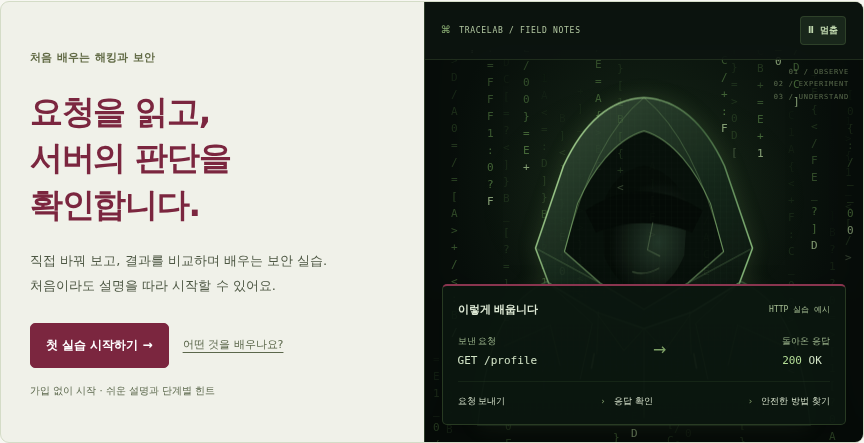

# 첫 화면의 코드 비와 해커 실루엣

첫 화면은 왼쪽의 쉬운 설명과 시작 버튼, 오른쪽의 움직이는 장면으로 구성합니다. 모바일에서는 설명과 버튼 아래에 장면을 놓습니다. 버건디가 주요 색이고 초록색은 오른쪽 그래픽 안에 사용합니다.



[모바일 화면 보기](previews/hero-mobile.png). 이미지에는 한 순간을 담았으며 실제 사이트에서는 문자와 실루엣이 움직입니다.

## 세 파일의 역할

| 파일 | 배우면 좋은 내용 |
| --- | --- |
| [`site/hero.html`](../site/hero.html) | HTML의 의미 있는 구조, 버튼과 SVG 그림 |
| [`site/hero.css`](../site/hero.css) | Grid 반응형 배치, 레이어와 색상·깊이 |
| [`site/hero.mjs`](../site/hero.mjs) | Canvas, 시간에 따른 이동, 화면 밖 재생 중지 |

수정 후 `npm run build`를 실행하면 홈페이지와 배포 파일에 반영합니다. `index.html`의 `TRACE_HERO` 부분은 생성된 내용이므로 위 원본을 수정하세요.

## 1. 레이어로 깊이 만들기

뒤쪽 Canvas → 후드 실루엣 SVG → 앞쪽 Canvas → 읽을 수 있는 고정 패널 순서로 겹칩니다. `z-index`가 앞뒤 순서를 정합니다. 앞쪽 문자는 뒤쪽보다 드물고 투명해 인물이 보입니다.

SVG의 `path`는 그림의 윤곽을 좌표로 적습니다. 그라디언트는 후드 천의 명암을 만들고, 작은 패턴은 표면의 질감을 만듭니다. 외부 이미지나 라이브러리를 가져오지 않습니다.

## 2. 문자 흐름 만들기

`resize()`가 화면 크기에 맞춰 문자 열을 준비합니다. 열마다 시작 위치, 속도, 꼬리 길이가 다릅니다. `paint()`는 현재 시간에 맞춰 문자를 그립니다.

```js
const head = (column.offset + elapsed * column.speed)
  % (height + column.length * 17);
```

`elapsed`는 실제 재생한 시간(초), `speed`는 초당 내려오는 거리입니다. `%`는 아래로 빠져나간 문자가 위에서 다시 들어오게 합니다. 꼬리의 투명도를 낮춰 내려오는 흐름을 보여줍니다.

## 3. 실루엣을 천천히 내려보내기

약 19초 주기로 실루엣의 위치와 투명도를 바꿉니다. 처음 접속했을 때도 인물이 보이는 위치에서 시작합니다. 내려오는 끝부분에서는 흐려지고 다시 위에서 나타납니다. 설명과 예시 패널은 움직이지 않습니다.

## 4. 성능과 접근성

- 문자는 초당 최대 24회 그립니다. 고해상도 화면에서도 Canvas 배율을 1.5로 제한합니다.
- 화면 밖, 다른 메뉴, 실습 창을 연 상태, 브라우저의 숨겨진 탭에서는 재생을 멈춥니다.
- 사용자가 ‘멈춤’ 버튼으로 정지하고 다시 재생할 수 있습니다.
- 운영체제의 ‘움직임 줄이기’를 켜면 정적인 그래픽을 보여줍니다.
- 그래픽은 스크린 리더에서 생략하고, 학습 흐름과 시작 버튼은 HTML로 읽을 수 있습니다.

`GET /profile`과 `200 OK`는 학습 과정을 설명하는 고정 예시입니다. 그래픽은 실제 서버 요청이나 해킹을 수행하지 않습니다.
